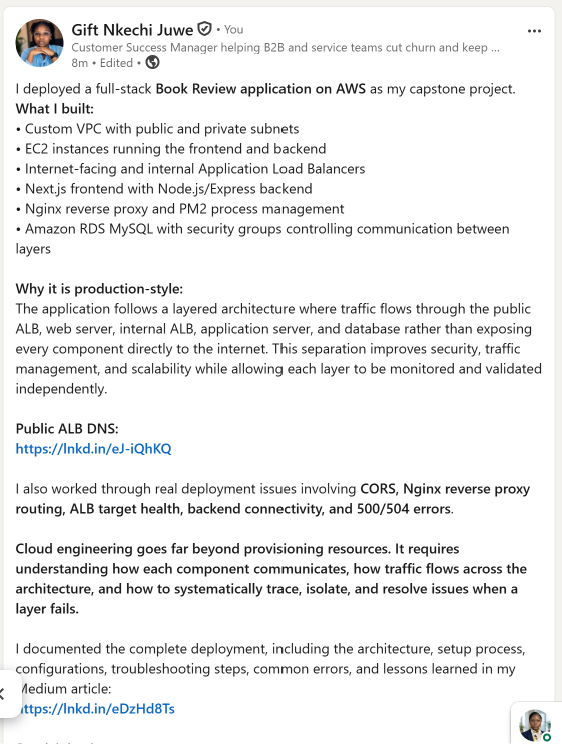

# Assignment 6 — Capstone Assignment — Deploy Book Review App (Three-Tier Architecture) on AWS

Part of the DevOps Micro Internship (DMI) Cohort 3 with Agentic AI

---

## Purpose

This is the most important assignment of the course. You will deploy the Book Review App in a fully production-style three-tier architecture on AWS: a Next.js Web Tier behind Nginx and a public ALB, a private Node.js/Express App Tier behind an internal ALB, and a private Multi-AZ MySQL RDS database with a read replica. You are expected to design, deploy, isolate, debug, and document the result independently.

---

# Task 1 — Architecture Diagram

## Goal

Create an architecture diagram showing the custom VPC (10.0.0.0/16), the six subnets across two Availability Zones (two public Web Tier, two private App Tier, two private Database Tier), the public ALB, Web Tier EC2/Nginx, internal ALB, private App Tier EC2, private Multi-AZ RDS with its read replica, and the permitted traffic flow.

### Evidence

#### Diagram image or link

---

# Task 2 — AWS Region & Services Used

## Goal

Record the AWS Region used and list every AWS service used across networking, compute, load balancing, security, and the database.

### Notes

**Region:**

Europe (Stockholm) — eu-north-1

---

**Services:**

Networking
Amazon VPC — Custom VPC for the application infrastructure.
Amazon VPC Subnets — Public and private subnets across Availability Zones.
Internet Gateway (IGW) — Internet connectivity for the public subnets.
NAT Gateway — Outbound internet connectivity for resources in private subnets.
Route Tables — Controlled routing between public/private subnets and gateways.

Compute
Amazon EC2 — Hosted the web/frontend and application/backend components.
EC2 Launch Template — Configuration template used for EC2 instance deployment.
EC2 Auto Scaling Group — Managed the application EC2 capacity and instance availability.

Load Balancing
Application Load Balancer (ALB) — Internet-facing ALB used as the public entry point.
Internal Application Load Balancer — Routed requests privately from the web tier to the application tier.
Target Groups — Registered EC2 instances and performed health checks for the ALBs.

Security
Amazon EC2 Security Groups — Controlled traffic between the ALB, EC2 instances, and other application components.
Amazon RDS Security Group — Restricted database access to authorized application resources.

Database
Amazon RDS for MySQL — Hosted the Book Review application's MySQL database.
DB Subnet Group — Associated the RDS database with the designated database subnets.
Application/Server Components Running on EC2

These are not separate AWS services, but they were part of the deployed application stack:

Nginx — Reverse proxy/web server.
Node.js/Express — Backend API.
Next.js — Frontend application.
PM2 — Node.js process manager.
Region

AWS Region used: eu-north-1 — Europe (Stockholm)

---

# Task 3 — Public Entry Point

## Goal

Confirm the Book Review App loads through the public ALB DNS name.

### Evidence

#### Public ALB DNS

Paste your public ALB DNS name here:

http://book-review-web-alb-887968689.eu-north-1.elb.amazonaws.com

This is the internet-facing Web ALB that serves as the public entry point to your Book Review application.

The request flow is:

Internet → Public Web ALB → Web EC2/Nginx → Internal ALB → Application EC2/Node.js → RDS MySQL

---

# Task 4 — Evidence Screenshots

## Goal

Capture visual proof of every tier and load balancer.

### Evidence

#### Web EC2

---

#### App EC2

---

#### Public ALB

---

#### Internal ALB

---

#### RDS + Replica

---

#### App UI proof

---

# Task 5 — Summary

## Goal

Summarize what worked in the final deployment, the issues encountered and how each was fixed, and the tools or sources used to research and debug.

### Notes

**What worked:**

The final Book Review application was successfully deployed on AWS using a multi-tier architecture. The public-facing application was accessible through the internet-facing Application Load Balancer (ALB), with Nginx serving as the reverse proxy on the web tier. The Next.js frontend communicated with the Node.js/Express backend through the internal ALB, while the backend connected to the Amazon RDS MySQL database.

The final deployment included:

Custom VPC with public and private subnets
EC2 instances hosting the application components
Internet-facing and internal ALBs
Target groups with health checks
Nginx reverse proxy
Next.js frontend
Node.js/Express backend
PM2 process management
Amazon RDS MySQL
Security groups controlling traffic between tiers
User registration and login functionality
Book API successfully returning data from the database

The application was tested at multiple layers using direct backend requests, Nginx, ALB routing, and the public application endpoint.

---

**Issues + fixes:**

1. CORS errors during registration and login

Issue:
Browser requests to the registration and login endpoints returned errors because the frontend origin was not correctly included in the backend's allowed CORS origins.

Fix:
Updated ALLOWED_ORIGINS in the backend .env file to include the correct ALB origin and restarted the backend with PM2.

2. Frontend API routing

Issue:
The frontend initially used a direct backend URL, which was not appropriate for the final load-balanced architecture.

Fix:
Configured the frontend to use:

NEXT_PUBLIC_API_URL=/api

This allowed browser requests to go through Nginx and the appropriate load-balancing layer.

3. Nginx 504 Gateway Timeout

Issue:
Requests such as /api/books returned 504 Gateway Timeout.

Investigation:
Checked the Nginx configuration and logs and identified that Nginx was unable to reach the internal ALB upstream.

Tools used:
curl, nginx -T, and /var/log/nginx/error.log

Fix:
Validated the internal ALB, target group, routing, security groups, and connectivity between the web tier and application tier until the upstream connection was restored.

4. ALB target health issues

Issue:
The application target became unhealthy with Request timed out reported by the target group.

Investigation:
Checked the registered target, health-check configuration, application port, EC2 processes, and security-group rules.

Fix:
Verified that the backend was listening on port 3001, that the application process was running, and that the appropriate traffic was permitted between the load balancer and EC2 instance.

5. PM2 application/process issues

Issue:
The frontend and backend processes experienced restarts and port conflicts during deployment.

Fix:
Used PM2 to inspect process status and logs, restarted the affected processes, and verified that both frontend and backend processes remained online.

6. Database connectivity

Issue:
The backend initially experienced database connection/authentication issues while connecting to Amazon RDS MySQL.

Fix:
Verified the RDS endpoint, database credentials, security-group access, database configuration, and SSL connection settings. The backend subsequently connected successfully and the database schema was updated.

7. Local versus production testing

Issue:
The application worked when tested directly on the EC2 instance but did not always work through the ALB/browser.

Fix:
Tested each layer independently instead of assuming that a working local API meant the complete deployment was healthy.

This helped isolate problems between:

Browser → Web ALB → Nginx → Internal ALB → Node.js → RDS

---

**Tools/sources used:**

AWS Console
Amazon VPC
EC2
Application Load Balancer
Target Groups
Security Groups
Amazon RDS
Route tables and subnet configuration

Linux/Server troubleshooting
curl — Tested API endpoints and connectivity
ss — Verified listening ports
ps — Checked running processes
pm2 status — Checked application processes
pm2 logs — Investigated application errors
nginx -T — Verified Nginx configuration
Nginx error/access logs — Investigated upstream and proxy errors
systemctl — Managed and checked server services

Development tools
Node.js
npm
Next.js
Express
MySQL
Nginx
PM2
Git/GitHub

Research/Documentation
AWS documentation and console documentation
Nginx documentation
Node.js/Express documentation
Next.js documentation
PM2 documentation
MySQL/RDS documentation
Error messages and application/server logs used as primary debugging evidence

---

# LinkedIn Post (Required)

## Goal

Publish a LinkedIn post sharing the capstone deployment, including the public ALB DNS (or a redacted screenshot), three to five lines on what you built and why it is production-style, and one proof screenshot.

## Evidence

#### LinkedIn Post URL

Paste your LinkedIn post URL here:

https://lnkd.in/p/eNpQS3EJ

---

#### Screenshot of LinkedIn post

---

# Submission Instructions

- Add all required screenshots and links in your submission
- Do not expose passwords, RDS credentials, connection strings, private keys, or account IDs

---

# Completion Checklist

- [ ] Task 1: Architecture diagram completed
- [ ] Task 2: AWS Region and services documented
- [ ] Task 3: Public ALB DNS confirmed working
- [ ] Task 4: All six evidence screenshots captured (Web Tier, App Tier, both ALBs, RDS + replica, app UI)
- [ ] Task 5: Deployment summary completed (what worked, issues/fixes, tools/sources)
- [ ] LinkedIn post published and URL submitted
- [ ] App Tier and Database Tier confirmed not publicly accessible
- [ ] No sensitive data exposed

---

## 📌 About DMI & CloudAdvisory

DevOps Micro Internship (DMI) is a project-based DevOps program run by Pravin Mishra (The CloudAdvisory) focused on real-world execution, systems thinking, and career readiness.

It helps learners build strong DevOps foundations with hands-on experience.

---

## 📌 Resources

- 🌐 DMI Official Website: https://dmi.pravinmishra.com?utm_source=github&utm_medium=readme  
- 🎓 University: https://university.pravinmishra.com?utm_source=github&utm_medium=readme  
- 💬 Discord Community: https://discord.pravinmishra.com?utm_source=github&utm_medium=readme  
- 📝 Blog: https://dmi.pravinmishra.com/blog?utm_source=github&utm_medium=readme  
- ▶️ YouTube Playlist: https://www.youtube.com/playlist?list=PLFeSNDtI4Cho  
- 🔗 Pravin Mishra (LinkedIn): https://www.linkedin.com/in/pravin-mishra-aws-trainer/  
- 🏢 CloudAdvisory (LinkedIn): https://www.linkedin.com/company/thecloudadvisory/

---

*This submission is part of DevOps Micro Internship (DMI) Cohort 3 — Agentic AI Track.*